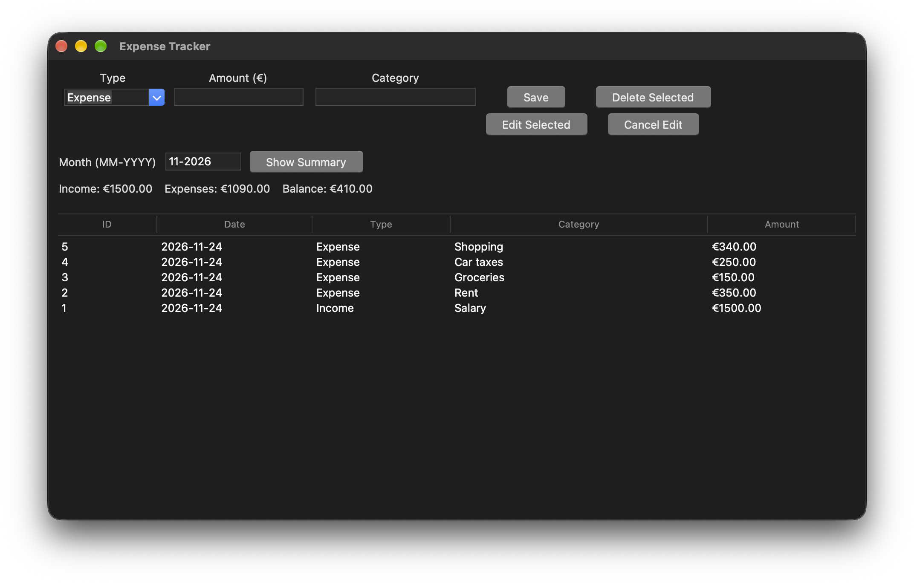

# Expense Tracker

A desktop app built with Python, Tkinter, and SQLite for tracking income and expenses.



## Features

- Add, edit, and delete transactions from the desktop interface.
- Enter euro amounts with a decimal point or comma.
- View monthly income, expenses, and balance.
- Keep transactions in a local SQLite database between runs.

## Run locally

Use Python with Tkinter support. To check that Tkinter is available, run
`python3 -m tkinter`. A test window should open.

```bash
python3 -m venv .venv
source .venv/bin/activate
python gui.py
```

Select **Income** or **Expense**, enter an amount such as `13.50`, add a
category, and click **Save**. To see the monthly totals, enter a month in
`MM-YYYY` format and click **Show Summary**.

The app creates `expenses.sqlite3` in the project folder on first launch.

## Project structure

| File | Role |
| --- | --- |
| `gui.py` | Tkinter interface |
| `main.py` | Terminal interface |
| `transaction.py` | Transaction model |
| `transaction_repository.py` | SQLite queries and monthly totals |
| `database.py` | Database connection and schema setup |
| `test_transaction_repository.py` | Integration test against a temporary SQLite database |

## Run the test

```bash
python -m unittest -v test_transaction_repository
```

The test checks that an expense can be added, edited, and deleted, and that
the monthly total reflects each change.
